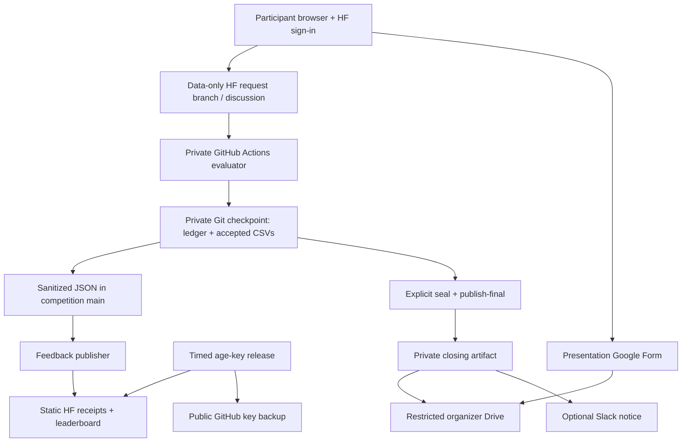

# Competition platform handover

This is the maintainer's entry point for deploying, operating and adapting the
GitHub + Hugging Face platform. It documents secret **names and permissions**;
secret values, hidden labels and private calibration never belong in this repo.

**Audited 23 October 2026:** competition `main` at `f65ed58`; private evaluator
`main` at `a4dfe40`. These revisions identify this audit, not participant download
choices. Check current main branches and hosted receipts before operating.
A workflow existing in Git does not prove that it is armed or working.

## Find the right procedure

- Current event: [activation gaps](#current-activation-gaps), [schedule](#release-times-and-workflows), [event-day operations](#event-day-operations).
- Fresh deployment: [setup in dependency order](#setup-in-dependency-order).
- Another project: [migration checklist](#reuse-for-another-project). A fork plus new JSON is insufficient.
- Failures: [recovery](#recovery-and-shutdown).
- Organizer-only detail: private evaluator [RUNBOOK](https://github.com/hulaearth/ai-for-nature-evaluation/blob/main/RUNBOOK.md), [PRE_EVENT_CHECKLIST](https://github.com/hulaearth/ai-for-nature-evaluation/blob/main/PRE_EVENT_CHECKLIST.md), [launch evidence](https://github.com/hulaearth/ai-for-nature-evaluation/blob/main/config/launch-evidence.json). These links require organizer access.

## Architecture and access boundaries

| Component | Destination | Responsibility |
| --- | --- | --- |
| Public source/state | [hulaearth/ai-for-nature-competition](https://github.com/hulaearth/ai-for-nature-competition) | Pages, browser bundle, sanitized roster/receipts/leaderboard, test-key release |
| Static Space | [HulaEarth/ai-for-nature-hula-earth](https://huggingface.co/spaces/HulaEarth/ai-for-nature-hula-earth) | HF sign-in, registration, encrypted upload and feedback; no inference service |
| **Private** evaluator | [hulaearth/ai-for-nature-evaluation](https://github.com/hulaearth/ai-for-nature-evaluation) | Trusted scorer, identity registry, labels, accepted CSVs, durable ledger and closing reports |
| Starter | [hulaearth/ai-for-nature-codebase](https://github.com/hulaearth/ai-for-nature-codebase) | Training, validation, decryption, inference and method reports |
| Public German rasters | [HulaEarth/alphaearth-germany-2024](https://huggingface.co/datasets/HulaEarth/alphaearth-germany-2024) | Separate advance AlphaEarth downloads |
| Competition data | [HulaEarth/ai-for-nature-rasters](https://huggingface.co/datasets/HulaEarth/ai-for-nature-rasters) | Tables, patches, companions, mapping and encrypted final inputs |
| Drive mirror | [Challenge data](https://drive.google.com/drive/folders/1gXsJyZnI8QIbk1RQYL0qNqy1yf0eSaoT) | Download-only participant folder; company parent and organizer folders stay restricted |
| Presentation collection | Form respondent URL in event/public config | PDFs and responses stay organizer-private |
| Event website | [ai-for-nature.hula.earth](https://ai-for-nature.hula.earth/) | Current starter-download release owner; deployed separately |



Participants run their models themselves. Evaluation reads bounded data files;
it never runs submitted code or checks out participant branches. Upload success
means **received**, not **accepted**. Private validation and a successful private
checkpoint precede acceptance publication.

**No GitHub/HF submission webhook is required.** The worker polls the HF inbox
and backup GitHub issues. The optional outgoing Slack webhook and signed Google
Apps Script receiver serve reporting only. Adding an HF webhook does not start
or replace this evaluator.

## Current activation gaps

Component tests and rehearsals are extensive, but some documentation describes
superseded procedures. Do not declare the current event ready from an old green run.

| Finding at the audited revisions | Required action |
| --- | --- |
| Private `data_ready=false` and `final_submissions_enabled=false`. | Complete acceptance evidence, deliberately arm, commit, sync and verify. Publishing a key does not enable scoring. |
| Public `release-materials.yml` is **retired** and only prints a message. | Verify the external website's actual starter/guide release. Running this workflow publishes nothing. |
| Event configs/participant copy say starter/guide **10:00**, but the retired workflow's website instruction says **11:00**. | Release owner must reconcile website, schedule, guide and readiness evidence. This audit did not change the agreed time or either service. |
| Readiness still checks `materials-release-setup.json` from the former release controller. | Bind certification to the replacement delivery and exact frozen starter/guide. An old `armed=true` receipt does not certify the website; do not fabricate a legacy receipt. |
| Public top-level `starter_commit` is older than the current materials/private delivery pin. | Sync the release contract from the private evaluator. The scoring baseline has its own intentionally frozen commit: preserve that separate provenance. |
| Private launch evidence has unresolved gates. | Finish two-account acceptance/restart, ordinary participant delivery, external Google-account presentation upload, office network coverage, Actions allowance, independent backup access and restore. |
| Independent HF data release was activated and hosted **verify** passed on 23 October. | Preserve the verified tree; check actual anonymous downloads at 10:00. Do not activate the older combined Drive/HF proposal. |
| HF data use manual gating after private conversion hit storage quota; Drive was last recorded as link-readable. | Check each provider's real permissions. Gating hides downloads, not metadata. The HF release does not change Drive. |
| Older private guides contain obsolete row counts, metric descriptions and release instructions. | Production is `aifn/`, `config/event.json`, `state/ledger.json` and current workflow YAML. `legacy-demo/`, `evaluation/` and `results/ledger.json` are not live scoring/state. |

The read-only local audit on 23 October passed bundle integrity, actual scoring
smoke test, frozen reference reproduction, transport capacity, times and registry.
It reported **seven unresolved acceptance gates**, with both launch flags false;
it did not certify provider credentials or unattended launch. Private launch
evidence remains the record of outstanding work. This documentation update does
not change access, keys, schedules or launch flags.

## Configuration authority and operators

| File / object | Controls | Ownership |
| --- | --- | --- |
| Private `config/event.json` | IDs, hashes, quotas, times, launch flags, organizer HF IDs and links | Scoring authority; review before acceptance opens |
| Private `state/ledger.json` | Native teams, invitations, receipts, attempts, choices, sealed results | Worker-owned; never replace during the same event |
| Private `config/teams.json` | Legacy seeds/bindings | Native ledger registry takes precedence, including an empty registry |
| Public `config/challenge.json`, `site/config.json` | Published contract | Export via private **sync**; do not maintain a competing configuration |
| Public `config/schedule.json`, `config/scoring.json` | Schedule and award explanation | Align with private policy; rebuilding pages does not update the evaluator |
| Public `config/test-key-release.json` | age fingerprint, unlock/expiry | Must match event config and actual ciphertexts |
| Public `config/materials-release.json` | Retained starter/guide pins | Still read by checks; not an active scheduler |
| Private `config/hf-data-release.json` | Dataset, complete tree fingerprint, manifests and probe | Re-audit after any file addition/removal/change |
| Private `config/launch-evidence.json`, `docs/rehearsals/` | Checksummed acceptance proofs | Bind event, manifest, starter, RSA key ID and Space; proofs expire after three days |
| Private `config/reporting.json`, `config/point-maps.json` | Closing diagnostics and map binding | Remain organizer-private |

Assign a release operator, evaluation operator, presentation/jury operator and
independent backup with tested access. Record names and key custody privately.
An allowlisted HF organizer ID grants app controls, not GitHub, Drive or billing access.

## Secrets, keys and permissions

Install under repository **Settings → Secrets and variables → Actions**. Secrets
do not transfer with a fork/copy. A listed name proves neither its value, scope,
organization approval nor expiry; exercise its workflow.

| Secret / variable | Repository | Purpose / scope |
| --- | --- | --- |
| `HF_SPACE_TOKEN` or `HF_TOKEN` | Competition secret | Fine-grained HF write access to this **Space**: deploy, feedback, key publication. Workflows prefer `HF_SPACE_TOKEN` when both exist. |
| `TEST_RELEASE_KEY` | Competition secret | Complete **age identity file** for final inputs. `TEST_DATA_UNLOCK_KEY` is a legacy fallback. Must match frozen key fingerprint. |
| `HF_DEPLOY_ENABLED` | Competition **variable** | Use `true`. Only string `false` skips full site deployment; this is not a global feedback/key-release kill switch. |
| `SUBMISSION_PRIVATE_KEY` | **Private evaluator** secret | Complete unencrypted **RSA-3072 PEM** for prediction/registration decryption. Never publish it. |
| `COMPETITION_PUBLISH_TOKEN` | **Private evaluator** secret | Fine-grained GitHub PAT: organization resource owner, **only competition repo**, Contents and Issues read/write. No evaluator access; approval/expiry must cover event and reconciliation. |
| `DATA_RELEASE_HF_TOKEN` | **Private evaluator** secret | HF write/settings access to the challenge **dataset**. Separate from Space token; opens the fixed dataset. Current credential also covers the separate raster repo, not the whole organization. |
| `GITHUB_TOKEN` | Automatic per Actions job | Repository-scoped runtime credential with explicit YAML permissions. Never create a PAT named this. Contents write persists state/key backup; Actions write allows poll disable. |
| `ORGANIZER_SLACK_WEBHOOK` | **Private evaluator**, optional | Incoming webhook to one intended private organizer channel; app scope only `incoming-webhook`. |
| `ORGANIZER_DRIVE_GATEWAY_URL`, `ORGANIZER_DRIVE_GATEWAY_KEY` | **Private evaluator**, optional | Apps Script `/exec` URL plus upload HMAC secret; both needed for automatic report delivery. Not Google login credentials. |
| `ORGANIZER_MAP_POINTS_1` … `_4` | **Private evaluator**, optional | Bounded compressed private map payloads, not account credentials; prepared with `scripts/prepare_point_maps.py`. |
| `MATERIALS_RELEASE_TOKEN` | Competition, **legacy only** | Former visibility release: only competition + starter, Administration read/write and Contents read. Retired workflow does not use it. Do not create it for the website route unless deliberately restoring the old controller. |

Private `configure_credentials.py` stores separate organizer deployment, publisher
and Space credentials in a protected local directory. Its setup PAT uses Contents,
Actions, Issues, Secrets and Variables read/write on the three named GitHub repos;
that broader **setup** credential stays local. `deploy_configuration.py` installs
only RSA, publisher, Space token and deploy variable, not every secret above.
Its RSA input is `submission-envelope-v1.pem` under `AIFN_PLATFORM_PRIVATE`
(otherwise the original organizer storage default). Point that variable to the
new protected key directory before setup; keep its receipt output there as well.
Port destination guards before using it for another project. Never paste
credentials into chat/issues, source, logs or command arguments.

### Two independent encryption keys

| | Prediction envelopes | Final input archives |
| --- | --- | --- |
| Encryption | RSA-OAEP-SHA256 wraps AES-256-GCM key | age |
| Private material | PEM / `SUBMISSION_PRIVATE_KEY` | Identity / `TEST_RELEASE_KEY` |
| Public material | `submission-key.json`: SPKI DER and SHA256 key ID | age recipient used when packaging; frozen identity fingerprint |
| Decryption | Private evaluator only | Participants after unlock |
| Release | **Never release RSA private material** | Deliberately publish age identity at test unlock |

For a new event, generate fresh independent keys **outside every repository**.
Do not rotate a live event's RSA key without a migration plan: old envelopes and
receipts still require the original key. Current decoder requires 3072 bits
because it checks a 384-byte wrapped key.

```bash
# From private evaluator checkout; sibling secrets directory is outside Git.
mkdir -m 700 ../event-secrets
umask 077
openssl genpkey -algorithm RSA -pkeyopt rsa_keygen_bits:3072 \
  -out ../event-secrets/submission-envelope-v1.pem
age-keygen -o ../event-secrets/test-release.agekey
```

Derive public JSON using the production helper, replacing `NEW-EVENT-ID`:

```bash
.venv/bin/python - <<'PY'
import json
from pathlib import Path
from cryptography.hazmat.primitives.serialization import load_pem_private_key
from aifn.crypto import public_document
key = load_pem_private_key(Path('../event-secrets/submission-envelope-v1.pem').read_bytes(), password=None)
document = public_document(key, 'NEW-EVENT-ID')
Path('public/submission-key.json').write_text(json.dumps(document, indent=2) + '\n')
print('Public key ID:', document['key_id'])
PY
```

Copy **only public JSON** to competition `site/submission-key.json`; set matching
`submission_key_id` in private/public config. Install PEM directly into its private
Actions secret. Encrypt all final components with the new age recipient and test
every component's authenticated decryption. Key-release fingerprint hashes the
single non-comment identity line, stripped, with **one trailing newline**; hashing
the entire age file including comments is wrong. This computes only the public
fingerprint and checks the production parser, without printing the identity:

```bash
python3 - <<'PY'
import hashlib
from pathlib import Path
# Run from competition checkout; the sibling file is outside Git.
from scripts.release_test_key import identity_from
raw = Path('../event-secrets/test-release.agekey').read_text()
lines = [s.strip() for s in raw.splitlines() if s.strip() and not s.lstrip().startswith('#')]
assert len(lines) == 1
fingerprint = hashlib.sha256((lines[0] + '\n').encode()).hexdigest()
identity_from(raw, fingerprint)
print('Test identity SHA256:', fingerprint)
PY
```

Put that fingerprint in the new key plan; keep independently recoverable
protected backups of both keys. Use `age-keygen -y` on the identity to derive the
public encryption recipient; the recipient is not the unlock identity.

## Setup in dependency order

### 1. Repositories and access

Create competition, **private evaluator**, starter, Static HF Space and dataset
repos. Use default branch **main**: workflows and receipt validation assume it.
Enable competition Issues for backup delivery and HF discussions/request uploads
on the public Space. Current HF transport reads requests anonymously; a private
submission Space requires a separately implemented/tested authenticated transport.

Grant operators access. Separate participant data from organizer reports, slides,
keys and recovery snapshots. Drive participants get Viewer only on the intended
folder, never company parent access. Link-readable is not team-specific access.
HF manual gating permits account approval but leaves metadata public.

### 2. GitHub Actions worker setup

Enable Actions and allow the pinned checkout/setup/upload actions under organization
policy. Standard **GitHub-hosted `ubuntu-24.04`** runners suffice: no VM, inbound
port, GPU, runner registration token or self-hosted daemon is required. Workflows
install Python **3.14.4** and browser builds use Node **24.19.0**. Evaluation uses
`requirements-lock.txt`, reports `requirements-report.txt`, browser `npm ci` lockfile.

Ensure organization/repository policy permits the YAML's explicit workflow token
permissions. Worker state and sanitized exports write directly to `main`. Branch
rules demanding a PR for every such update need an appropriately restricted
automation bypass or the worker will fail. Do not make the evaluator public.

Ask the organization owner to verify included **private Actions minutes**, storage,
concurrency, spending controls and credential expiry. The active worker occupies
a runner for the event; polls, rehearsals and reporting add usage. Static HF avoids
a CPU service but does not guarantee unlimited free private Actions. No automatic
capacity purchase is authorized.

A self-hosted alternative is a separate deployment: port `runs-on`, supply the
same runtime/network, restrict to trusted private workflows and review cleanup.
`aifn.active_worker.synchronize()` resets its **ephemeral Actions checkout** on
polls. Never point it at a person's working tree or let independent local/hosted
workers operate from divergent ledgers.

### 3. Frozen data and scoring

Prepare train/development/practice/final packages with source licenses/attribution.
Encrypt final **features**, retain labels privately and freeze manifests. Define
required IDs, byte caps, species, metric eligibility, public/private scoring,
quotas and baseline before submissions open.

Current contract: **159,150 predictions / 15,915 anonymous locations / ten species**;
header `row_id,score`, every ID once, finite scores in `[0,1]`; **24,000,000-byte
CSV / 36,000,000-byte envelope**. Five accepted final attempts and ten accepted
practice checks per team; 120-row Practice has no AP score. Invalid requests do
not spend accepted attempts; a separate invalid-request cap still applies.
Metric: **species macro average precision, pooling countries within species**,
not the older country-first description or AUROC demonstration.

Private `scripts/prepare_private_bundle.py` stages the minimal hidden bundle only
after actual remote privacy verification. `AIFN_DATA_RELEASE` can specify its
source root; source `FROZEN.json`, private source files/hashes and attribution
must match config. Preserve `private/scoring/reference-predictions.csv` and checked
`reference.json` on that contract. The helper does not prepare a new scientific
dataset or fit a reference model.

Awards: **50 model / 30 insights / 15 presentation / 5 reproducibility**; see
[scoring](docs/scoring.md). Private AP is converted relative to the fixed reference.
The `1/6` anchor reflects this benchmark's sampling; adapt hard-coded policy and
tests for a different task rather than changing only the prose.

### 4. Secrets and static deployment

Install required secrets above and verify scope, organization approval and expiry.
A PAT saved in Secrets may still be pending approval. Build/test public sources,
then run **Deploy static competition Space**, `main`, with
`clean_participant_history=false`. Only allowlisted public assets upload, with
remote hash checks and existing visibility preserved. Worker-owned config/roster/
receipts/leaderboard are deliberately excluded from ordinary page deployment.
Run private **Trusted private evaluation → sync**, then public **Publish team and
submission feedback** if needed. Verify actual browser config/key/roster consistency.

`scripts/deploy_space.py` writes these Space README settings:

```yaml
sdk: static
app_file: index.html
hf_oauth: true
hf_oauth_expiration_minutes: 60
hf_oauth_scopes:
  - write-discussions
```

Browser requests `openid profile write-discussions` through HF OAuth and uploads
as the participant. No shared organizer token or OAuth client secret belongs in
JavaScript. Test HF embed and standalone origin. Changing Space/domain requires
updated static links, OAuth return routing and destination guards, then rebuilding
`site/submission.js` from `submission-src/`.

Do **not** squash Space history, merge participant request branches or edit/remove
original provider receipts during registration/evaluation: trusted ancestry and
server commitments are validation inputs. History cleanup is destructive
maintenance, not a routine deployment step.

### 5. Release controllers and presentation collection

Use the workflow table below; run each current **verify** mode on `main` and keep
receipts. HF data access, age-key release, starter release and final arming are
independent controls. Resolve the current website migration/time conflict with
its maintainer. Website hosting credentials, backend storage, UTC clock and
release logs are outside this repo and were not certified by this audit.

For another project, choose **one** materials controller: verify website delivery,
or deliberately port/re-enable the retained materials script/workflow and its
reviewed repo allowlist/Administration PAT. The current workflow is a no-op.
Do not activate the older combined Drive/HF proposal alongside independent HF release.

Publish a Google Form collecting team slug, captain HF username, verified contact,
required PDF (currently 10 MB) and optional source (100 MB). Publish/test before
setting `presentation_form_open=true`; use only observed **respondent URL** in
`presentation_form_url`. Editor/results/upload storage stay private. Test an
external Google account: upload requires sign-in and company policy may block it.
Configure/verify deadline closure in Forms itself; app flags cannot close Forms.
Keep latest timely valid response and timestamp/hash. Slides do not select a model.

### 6. Acceptance, then deliberate arming

Complete [acceptance checks](#acceptance-tests-and-evidence). Readiness phases:
**preflight** accepts expected closed flags; **armed** requires data/final flags;
**live** also requires active teams and a current trusted heartbeat. Evidence binds
the exact event, manifest, starter, key and Space and must reflect real observations.

Once genuinely passed, set `data_ready=true` privately and deliberately arm using
explicit timezone-aware times. Current-event example, from evaluator checkout:

```bash
.venv/bin/python scripts/configure_event.py \
  --start '2026-10-24T11:00:00+02:00' \
  --deadline '2026-10-24T17:30:00+02:00' \
  --test-release '2026-10-24T13:30:00+02:00' \
  --drive-url 'https://drive.google.com/drive/folders/1gXsJyZnI8QIbk1RQYL0qNqy1yf0eSaoT' \
  --performance-points baseline-relative-v1 --enable-final
```

Helper checks local preflight and private bundle/reference. Omitting
`--enable-final` leaves finals **disabled**, even if previously enabled. It updates
private event settings and backup poll cron, not every scheduler, website, guide
or key/data plan. Review/commit on private main, run **sync**, check mirroring and
hosted `armed` readiness. Backend release/deadline guards still apply if armed
earlier. Never use page-only changes to bypass unresolved acceptance gates.

## Release times and workflows

Current local times: **Saturday 24 October 2026, Europe/Berlin, CEST (UTC+02:00)**.
These GitHub cron expressions use UTC. Germany changes offset the next day;
calculate future dates with `ZoneInfo('Europe/Berlin')`. Cron has no year field;
Python date/window guards make this a one-off event.

| Activity | Local / UTC | Controller |
| --- | --- | --- |
| HF data downloads open | 10:00 / 08:00Z | Private `release-hf-data.yml`: verifies whole tree, removes fixed dataset gate, checks anonymous downloads; no key/Drive/launch changes |
| Starter/guide | Config 10:00 / 08:00Z; website instruction 11:00 / 09:00Z | **Unresolved migration**; external website owns delivery, `release-materials.yml` retired |
| Worker warm-up / processing | 09:47 / 07:47Z; processes from 10:00 / 08:00Z | Private `active-worker.yml` and reusable `active-session.yml` |
| Modeling | 11:00 / 09:00Z | Conduct rule; readable data cannot enforce analysis embargo |
| Test age key | 13:30 / 11:30Z | Public `release-test-key.yml`, independent GitHub backup + HF publication, time/fingerprint guarded |
| Predictions/choice/method/slides deadline | 17:30 / 15:30Z | Provider receipt cutoff for predictions/choices; separate Form closure for slides |
| Earliest seal | 17:32 / 15:32Z | Explicit private `evaluate.yml`, operation `seal`, after reconciliation |
| Active coverage ends | 17:45 / 15:45Z | Deadline +15 min; successful processing also disables backup poll |
| Final results/report | Explicit decision after reconciliation | `publish-final`, then separate private closing report |

| Repository / workflow | Triggers and operational details |
| --- | --- |
| Competition `test.yml` | Public source/PR checks, no private secrets |
| Competition `deploy-space.yml` | Matching main source/config pushes or manual full deployment |
| Competition `publish-feedback.yml` | Worker JSON pushes, manual, event five-minute retries. Coalesces identical writes; minimum 90 s between mirrors. Visible board refreshes about every 30 s |
| Competition `release-test-key.yml` | Verify on matching main push; manual/scheduled publish. Warm-ups **12:47, 13:02, 13:17** local; retries **13:32, :37, :42**. Waits until 13:30; expires at deadline |
| Competition `release-materials.yml` | **Retired** manual informational job; publishes nothing, changes no visibility |
| Evaluator `release-hf-data.yml` | Verify/manual publish. Warm-ups **09:42, :47, :52, :57**; retries **10:02, :07, :12, :17**. Window 10:00 to deadline |
| Evaluator `active-worker.yml` / `active-session.yml` | Automatic 09:47 or manual `rehearsal` / `event`. Ten-minute rehearsal; event sessions bounded to four hours, continuation/recovery jobs, 260-minute job timeout |
| Evaluator `poll.yml` | Five-minute event-day backup; guard materials time through deadline +1 hour. Successful drain at deadline +15 min disables only this workflow |
| Evaluator `evaluate.yml` | Manual/reusable `process`, `sync`, `seal`, `publish-final`; serialized durable state and main/private guard |
| Evaluator `readiness.yml` | Manual read-only `preflight`, `armed`, `live`; never arms finals |
| Evaluator `approve-team.yml`, `bind-hf-captain.yml` | Legacy organizer-only GitHub registration/binding backup; not ordinary native registration |
| Evaluator `closing-report.yml` | After final publication or manual production/rehearsal; private artifact, optional Drive/Slack |
| Evaluator `slack-check.yml`, `organizer-map-check.yml`, `test.yml` | Optional live connection/map transport checks; synthetic contract tests |

Example dispatches with authenticated GitHub CLI and workflow permission, targeting
main. Adapt destinations/guards before reuse:

```bash
# Safe verification: no key/data release.
gh workflow run release-test-key.yml -R hulaearth/ai-for-nature-competition --ref main -f mode=verify
gh workflow run release-hf-data.yml -R hulaearth/ai-for-nature-evaluation --ref main -f mode=verify
gh workflow run readiness.yml -R hulaearth/ai-for-nature-evaluation --ref main -f phase=preflight
gh workflow run active-worker.yml -R hulaearth/ai-for-nature-evaluation --ref main -f mode=rehearsal

# Operator actions: affect durable state/public feedback.
gh workflow run evaluate.yml -R hulaearth/ai-for-nature-evaluation --ref main -f operation=process
gh workflow run evaluate.yml -R hulaearth/ai-for-nature-evaluation --ref main -f operation=sync
```

Schedules can be late/dropped. Check an actual running warm-up, not a queued run.
Manual `publish` retains server-time guards; no CLI clock override exists. Key
workflow can succeed with **either** route: inspect `github_backup_verified` and
`hf_space_verified` to learn what passed.

Key outputs: HF `test-key-release.json`, `test-release-key.agekey`; GitHub
`releases/test-key/` equivalents. Pre-event `*-setup.json` contains fingerprints
and verification only, **not** unlock material. RSA PEM never goes to these paths.

## Optional webhooks and reporting

### Slack

Create/reuse organizer app with only `incoming-webhook`; installer must access the
chosen private channel. Save URL directly as evaluator `ORGANIZER_SLACK_WEBHOOK`.
Use private `config/slack-app-manifest.json` and [Slack setup](https://github.com/hulaearth/ai-for-nature-evaluation/blob/main/docs/SLACK_SETUP.md).
For another destination port channel/name/run-URL guards in `aifn/report_notify.py`
and `aifn/slack_check.py`.

Run **Organizer Slack connection → inspect**, then explicitly **send-test** and
verify the labelled notice in the correct channel. Same successful run must not
send twice. Synthetic report rehearsals send no Slack notice. For uncertain
timeouts inspect channel before explicit retry. This webhook triggers no scoring.

### Signed organizer Drive receiver

The laptop's Drive connector is not an Actions credential. Reporting uses private
`scripts/drive_receiver/Code.gs` and `appsscript.json` as an owner-deployed web app:

1. Create **restricted** organizer report folder; set its ID in receiver
   `ROOT_FOLDER_ID` and Python `aifn/report_drive.py` sender destination.
2. Review/authorize manifest. DriveApp requests owner's full Drive OAuth scope;
   fixed-folder restriction is enforced by code, not per-folder Google scope.
3. Generate random 32-byte HMAC key encoded as 64 lowercase hex characters. Save
   Apps Script `UPLOAD_HMAC_KEY` and evaluator `ORGANIZER_DRIVE_GATEWAY_KEY`;
   set Script Property `UPLOAD_EXPIRES_UTC` beyond event/report retries.
4. Deploy web app: execute as owner, access **Anyone**; save observed `/exec` URL
   as `ORGANIZER_DRIVE_GATEWAY_URL`. Reachable endpoint is public, uploads require
   fresh signed requests. Never put the shared key in source.
5. Run **Private closing report → rehearsal** with `deliver_rehearsal_to_drive`;
   verify downloaded files/hashes, signed receipt and permissions. Identical
   delivery must be idempotent. Unsigned requests create no files.

Receiver verifies signature, expiry/freshness, bounds and manifest and refuses a
public destination; it offers no arbitrary file access/sharing. Outer bounds:
30 MB compressed / 100 MB expanded. Current report folder has jury ZIP, PDF,
analysis ZIP, instructions and signed receipt. See private [Drive delivery](https://github.com/hulaearth/ai-for-nature-evaluation/blob/main/docs/DRIVE_DELIVERY.md).

Optional Drive/Slack steps preserve Actions artifacts on failure. Green overall
job with a `continue-on-error` step does **not** certify delivery. Without these,
retrieve the private artifact manually. Point-map payloads/coordinates remain
private; see [point-map setup](https://github.com/hulaearth/ai-for-nature-evaluation/blob/main/docs/POINT_MAP_REPORTING.md).

## Acceptance tests and evidence

Public checkout:

```bash
npm ci --ignore-scripts --no-audit --no-fund
npm run build:submission
python3 scripts/build_site.py
python3 scripts/check_site.py
python3 -m unittest discover -s tests -p 'test_*.py' -v
node --test tests/*.test.js
python3 -m http.server 8000 --directory site
```

Private evaluator checkout:

```bash
python3.14 -m venv .venv
.venv/bin/python -m pip install -r requirements-lock.txt
.venv/bin/python scripts/check_readiness.py --phase preflight
# Full suite includes reporting; requirements-report includes the evaluator lock.
.venv/bin/python -m pip install -r requirements-report.txt
.venv/bin/python -m unittest discover -s tests -v
```

Report tests additionally need `requirements-report.txt` and Node; use matching
hosted environment for full report rehearsal. Local readiness cannot certify
secrets, external accounts, provider access or network/capacity. Use hosted
**Read-only live launch readiness** for remote checks. Failure is an action list,
not a reason to weaken validation.

Required real acceptance, with a marked practice-only or otherwise excluded
organizer rehearsal team:

- Two independent HF accounts: captain registers/invites; colleague accepts on
  Register; both upload neutral Practice and get Accepted. Invitations are in-app.
- Refresh/sign-in and restart ten-minute worker: same receipt/CSV/count, no duplicate.
  Preserve original receipts; never impersonate the colleague.
- Local malformed-CSV rejection; synthetic tests for identity, tampering,
  duplicate/missing IDs, quota, deadline, selection, concealment, seal and reveal.
  No mock finals on production standings.
- Actual participant runtime: download/hash/unpack, baseline, current final row
  count, tables/patches and encrypted transport-part reconstruction in an authorized
  isolated rehearsal. Do not change the real clock or expose the key early.
- External Google-account Form upload, private retrieval/hash and deadline closure.
- Actual office devices/access points and concurrent archive downloads; provider
  fallback, licensing notices and checksum instructions.
- Owner-confirmed Actions allowance/concurrency/spending; real backup permissions
  and independently restored protected snapshot, not just acknowledged key custody.
- Current release fingerprints; anonymous actual downloads/decryption **after**
  release; intended denial/no key exposure before release.
- Closing report on actual jury laptop: extract `jury-slides.html`, select/reorder/
  export/present offline; optional Drive/Slack verified separately.

Record operator, UTC time, run/receipt links, runtime and expected/observed result
privately, bound to the current contract. Synthetic results do not close external
account/network gates. Unobserved checks remain pending.

## Event-day operations

1. **Before release:** verify operators/capacity/secrets/access, warm-ups, website
   timing, Form closure and protected snapshot; run appropriate readiness phase.
2. **Downloads/materials:** verify ordinary account access and exact files. Check
   Drive independently of HF. Confirm reconciled starter/guide time; modeling 11:00.
3. **Worker:** confirm event session really processes. Poll about 15 s; heartbeat
   about 60 s in public GitHub `site/worker-status.json`. Live readiness requires
   `running` and heartbeat younger than three minutes. Idle health updates do not
   trigger HF builds. Check `last_successful_poll` as well as job status.
4. **13:30:** verify key routes/decryption and scoring gate. Manual guarded
   `release-test-key.yml`, `mode=publish`, main if needed. Never release RSA.
5. **Before 17:30:** captain confirms Accepted and highlighted **Final choice**,
   method/code reference and presentation PDF. Confirmed teammates may upload,
   sharing quota; only captain chooses. Member upload preserves choice. Without
   explicit choice latest captain upload is fallback; member-only uploads need a choice.
6. **17:30:** provider receipt cutoff applies; timely complete valid request can
   be scored later. Check Form closure/timestamps; do not blindly resend uncertain uploads.
7. **17:32 or later:** drain/resolve transient failures; explicitly run
   `evaluate.yml`, `operation=seal`. Retain private commit and selection hash.
   Seal uses captain's choice, never the best private-scoring attempt.
8. **When ready:** explicitly `operation=publish-final`; review results and report.
   AP board and overall jury award are separate. Exact ties use earlier selected
   prediction's original receipt. Use private `python -m aifn.jury` to produce
   and validate worksheets; report delivery does not replace jury review.
9. **After event:** verify poll disable, remove cron, revoke no-longer-needed
   credentials/receiver, archive private ledger/CSVs/keys/manifests/credits and restore proof.

## Recovery and shutdown

| Symptom | Operator action |
| --- | --- |
| Pending registration/upload | Inspect worker/heartbeat; trusted main `process` or session. Keep original receipt; no duplicate team/upload. |
| Accepted privately, HF board stale | Check public GitHub receipts, retry `publish-feedback.yml`. Coalescing/rate limits do not undo acceptance/quota. |
| Credential HTTP 403 | Check resource/permission, organization approval, expiry, branch rules and secret precedence. |
| Key/config failure | Match RSA public ID, PEM and event config; repair infrastructure rather than reject all files. |
| Private push failed | Restart from current durable private main; no force-pushing a stale ledger or publishing acceptance first. |
| Delayed runner/exhausted minutes | Manual trusted workflow if available. Serialized organizer fallback needs identical ledger and tested credential/checkpoint transport; active worker is not a generic laptop daemon. Stop competing workers; no automatic purchases. |
| HF release rejects changed tree | Re-audit dataset/manifests and reviewed fingerprint. Never weaken the guard to bypass a mismatch. |
| HF key missing at 13:30 | Inspect per-route results/GitHub backup; retry guarded publish before expiry. If both providers fail use approved equal-distribution age-key fallback and record incident. |
| Final upload still closed | Check launch flags/current config, sync/mirror and time; key release is separate from arming. |
| Backup GitHub delivery needed | Conductor-directed `legacy-submit.html#submit`. Native teams lack inferred GitHub identity; recover original HF binding/receipt, not a second team. Routes share quota/choice. |
| Green closing job, missing Drive/Slack | Inspect each optional step; retrieve private artifact. Check receiver expiry/destination/HMAC or Slack channel before retrying uncertain delivery. |
| Need to stop unsafe route | Preserve state, review config and sync/announce fair fallback. `hf_submissions_enabled=false` stops HF inbox collection, including registrations; queued original receipts remain. Also review registration/UI flags rather than assuming every browser control disappeared. |

After the event, remove annual cron triggers even though Python guards reject other
dates. Preserve original immutable receipts and private history, never merge request
branches to tidy the Space. Revoke release/publisher/webhook credentials when report
retries finish, expire the receiver and test recovery from independently held storage.

## Reuse for another project

Start new destinations with schedules disabled and new keys. Do not publicly copy
private evaluator history: it includes hidden data, identities and submissions.
Use a reviewed code-only export, new hidden solution/reference and new acceptance
proofs. Initialize new state with the production `fresh_ledger()` helper and an
empty native registry; remove old legacy seeds from the new project's
`config/teams.json`. Never reset the ledger of an event with real receipts.

For a **new private code-only checkout**, after porting its event configuration
and with no existing state file:

```bash
.venv/bin/python - <<'PY'
import json
from pathlib import Path
from aifn.engine import fresh_ledger
from aifn.registry import registry
config = json.loads(Path('config/event.json').read_text())
ledger = fresh_ledger()
registry(ledger, [], config)
Path('state').mkdir(exist_ok=True)
with Path('state/ledger.json').open('x') as out:  # Refuse to overwrite any state.
    out.write(json.dumps(ledger, indent=2) + '\n')
PY
```

| Port together | Files/settings to review |
| --- | --- |
| Destinations/isolation | Public `config/*`, `scripts/deploy_space.py`, `publish_feedback.py`, `release_test_key.py`, retained `release_materials.py`, `submission-src/protocol.js`, `submission-src/app.js` raw GitHub URL and page-builder links; private event config, `aifn/hf_transport.py`, `active_worker.py`, credentials/deploy helpers and release scripts |
| Event/registration | New event ID, Space, RSA document/key ID, registration rules/version/epoch, stable organizer HF IDs, team capacity and fresh registry/history namespaces |
| Dates | Event/schedule/key/material/data JSON, all cron YAML, fixed START/END/repository in `release_hf_data.py`, fixed-time readiness checks/tests, website controller, Form closure and receiver expiry |
| Scientific contract | Manifest/opaque IDs, row count/caps, private bundle/eligibility/credits, practice, reference/calibration, metric; hard-coded `aifn/points.py` anchor/rubric/policy and tests |
| Publishing | Static Space README/OAuth/allowlist, feedback validators, static origin/raw URLs, default branch, artifact retention and automation write/bypass policy |
| Optional reports | Slack manifest/channel/run-URL guards; Apps Script + Python folder IDs, HMAC/expiry/bounds; map metadata/chunks, reporting assets, branding and rights |
| Participant material | New starter pin/guide hash, README/SUBMISSIONS/HTML, conductor/jury guides, forms, data notices, website/download links |
| Operations | New evidence/owners, real account/capacity checks, original receipts, off-device backup and independent restore |

Search code-only clones for old values before enabling workflows:

```bash
rg -n --hidden -g '!.git/**' -g '!node_modules/**' -g '!.venv/**' \
  -g '!private/**' -g '!state/**' -g '!output/**' -g '!tests/fixtures/**' \
  'hulaearth|HulaEarth|ai-for-nature-2026|2026-10-24|24 10 \*|cron:|space_id|repository' \
  config scripts .github
```

Also search `submission-src/` in competition and `aifn/` in evaluator, plus Google/
Slack IDs and rendered links. Rebuild generated `site/submission.js`; do not edit
it by hand. Do not replace old provenance blindly; generate new artifacts. A
different metric, duration, team size or sample prevalence requires code/tests,
not only prose. Current `configure_event.py` requires 6–7 hours and this award policy.

Finish acceptance on the **new** destinations, prove no writes can reach Hula's
event, then enable schedules and deliberately arm finals. Plan shutdown so an
abandoned annual cron cannot wake the event next year.

## Primary provider references

Code/YAML define this implementation. Recheck provider behavior/limits when reusing:

- [GitHub schedule/triggers](https://docs.github.com/en/actions/reference/workflows-and-actions/events-that-trigger-workflows#schedule)
- [GitHub workflow token](https://docs.github.com/en/actions/tutorials/authenticate-with-github_token)
- [GitHub Actions limits](https://docs.github.com/en/actions/reference/limits)
- [HF Static Spaces](https://huggingface.co/docs/hub/spaces-sdks-static)
- [HF OAuth](https://huggingface.co/docs/hub/spaces-oauth)
- [HF tokens](https://huggingface.co/docs/hub/security-tokens)
- [HF gated datasets](https://huggingface.co/docs/hub/datasets-gated)
- [Slack incoming webhooks](https://docs.slack.dev/messaging/sending-messages-using-incoming-webhooks/)
- [Google Apps Script web apps](https://developers.google.com/apps-script/guides/web)
