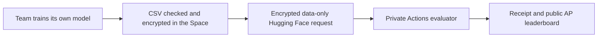

# AI for Nature · Bird habitat challenge

Build habitat rankings for ten birds from German observations, AlphaEarth embeddings, WorldCover, terrain and historical OpenStreetMap. Compare models on one common German validation set, then predict anonymous locations in nearby Central Europe. Teams of 2–3 work for 6.5 hours.

[Competition hub & rules](https://huggingface.co/spaces/HulaEarth/ai-for-nature-hula-earth) · [Challenge data](https://drive.google.com/drive/folders/1gXsJyZnI8QIbk1RQYL0qNqy1yf0eSaoT) · [Starter code](https://github.com/hulaearth/ai-for-nature-codebase) · [Participant guide at 10:00](https://huggingface.co/spaces/HulaEarth/ai-for-nature-hula-earth) · [Register](https://huggingface.co/spaces/HulaEarth/ai-for-nature-hula-earth#register)

## What teams deliver

- A valid prediction for all **159,150** bird-location requests.
- Clear, supported data insights and visualizations.
- A method/code reference and a presentation PDF by **17:30**.
- A **5-minute presentation + 2 minutes of questions**.

The award combines **50 model / 30 insights / 15 presentation / 5 reproducibility** points. Matching the fixed reference earns 15 model points; +0.15 AP earns 50. [Full scoring formula and evidence checklist](docs/scoring.md). Cross-species experiments use the same categories.

## Follow this route

1. Open **Register**, sign in with Hugging Face and create your team. Teammates sign in and accept invitations on that page; no invitation email is sent.
2. Download the **compact modeling tables** and follow the [starter quick start](https://github.com/hulaearth/ai-for-nature-codebase). Use the shared German validation set. Spatial cross-validation is optional.
3. Try the **120-row practice delivery** before the final rush.
4. Preload the encrypted final inputs; unlock at **13:30**. The compact tables and optional patches have exact byte sizes in Drive’s RELEASE.json manifest.
5. Open the Space’s **Submit** tab, sign in with your own confirmed team account and submit your CSV directly before **17:30**. The page checks, encrypts and uploads it. Keep the receipt and wait for Accepted.
6. Check your final choice. Leave “Make this my final entry if accepted” checked, or use “Use for final” beside an accepted entry. Add your method/code reference and upload slides through the separate presentation form.

[Submission instructions and examples](SUBMISSIONS.md) · [Practical guide](https://hulaearth-ai-for-nature-hula-earth.static.hf.space/index.html#guide) · [Data explanation](https://hulaearth-ai-for-nature-hula-earth.static.hf.space/index.html#data)

**Only the team captain can choose the final model.** Every confirmed teammate can upload, sharing the team’s allowance. The captain uses **Use for final** beside an accepted entry and checks its highlighted **Final choice** before 17:30. Choosing an existing entry uses no additional prediction attempt. Without an explicit choice, the latest captain upload is the fallback; if only teammates uploaded, the captain must select one.

Each team has five accepted final predictions and ten practice checks. Invalid files do not spend accepted attempts. The original unedited Hugging Face server receipt binds the request and ciphertext fingerprint; its timestamp controls eligibility, even when scoring is delayed. Exact score ties favor the earlier selected prediction receipt.

## Saturday 24 October 2026

All times are German local time: Europe/Berlin, CEST / MESZ (UTC+02:00). Before 11:00, only downloads and environment/account checks are allowed, including AI-agent work.

| Time | Program |
| --- | --- |
| 10:00 | Registration and coffee; starter code opens. The participant guide is released at 10:00. Environment checks only until 11:00. |
| 10:15 | Welcome and AI Nation introduction (Juliana Carneiro da Cunha Baumgartl, about 5 minutes). |
| 10:25 | Challenge brief by Hula Earth and Ames (maximum 10 minutes each), including the datasets. |
| 10:45 | Team formation, challenge/category confirmation and mentor introductions. |
| 11:00 | Hackathon modeling and analysis begin. Teams raise a hand for mentor help. |
| 13:00 | Lunch in the room; no fixed work break. |
| 13:30 | Test-key release on the Space; decrypt preloaded inputs and begin final inference/submissions. |
| 14:00 | Mentor round: every team gets a check-in, including data loading, inference and submission questions. |
| 16:30 | Feature-freeze checkpoint and second mentor round; focus on final inference, figures, slides and delivery. |
| 17:30 | Deadline for predictions, final choice, method/code reference and presentation PDF. |
| 17:45-19:45 | Presentations: 15 teams, 5 minutes + 2 minutes Q&A. |
| 19:45-20:00 | Jury deliberation and final reconciliation. |
| 20:00-20:15 | Awards ceremony. |
| 20:15-20:45 | Dinner and networking. |

## How the platform works



The evaluator scores data only; it never runs team code. Hidden labels and the submission-decryption key stay private. The separate test-input key is published at 13:30. Live public AP is provisional; the chosen entry’s private AP determines model points after closure. Presentations are collected in private organizer storage.

The Space checks both the primary and backup key routes automatically. If the Space is unavailable at release time, use the [backup unlock-key download](https://raw.githubusercontent.com/hulaearth/ai-for-nature-competition/main/releases/test-key/test-release-key.agekey), available from **24 October at 13:30 German time**. Its fingerprint is checked against the same frozen release plan.

Training data and technical pages are available in advance. The participant guide and starter code open at **10:00** on event day; analysis and modeling begin at **11:00**. No code or challenge guide belongs in the advance data folder. The data include technical documentation, licenses and checksums. Preserve the notices: the MIT code license does not relicense the observations or AlphaEarth data.

## Maintain this site

The Static Hugging Face Space needs no running CPU service. Build and check locally:

```bash
npm ci --ignore-scripts --no-audit --no-fund
npm run build:submission
python3 scripts/build_site.py
python3 scripts/check_site.py
python3 -m unittest discover -s tests -v
node --test tests/*.test.js
python3 -m http.server 8000 --directory site
```

Sources live in `config/`, `scripts/build_site.py`, `site/app.js` and `site/style.css`. Each HTML entry point includes the same design and navigation so linked pages remain styled. Deployment uploads only an explicit public allowlist and verifies its SHA256 hashes.

[Materials-release setup](docs/materials-release.md) · Test-key setup is described in the private runbook.

Organizers use the **private evaluator repository's PRE_EVENT_CHECKLIST.md and RUNBOOK.md** for readiness, credentials, approval, queue processing and closure. The timed jobs need verified permissions and an operator fallback; team corrections, final sealing and judging remain human responsibilities. This repository and the Space are public by organizer approval. Keep the starter private until its 10:00 release and the evaluator private throughout.

Optional German GeoTIFFs are also available from the [Hugging Face raster mirror](https://huggingface.co/datasets/HulaEarth/ai-for-nature-rasters). These are byte-identical to the frozen raster files; keep their license notices and verify SHA256SUMS.

Optional [Germany mapping inputs](https://drive.google.com/drive/folders/1MXcAoRPddo4ZrOCaFrhFeTClM_yi3fe1) are available at 1 km (866.9 MB) and 5 km (58.3 MB), with a [Hugging Face mirror](https://huggingface.co/datasets/HulaEarth/ai-for-nature-rasters/tree/main/mapping). They contain predictor tables/rasters and hillshade for mapping participants’ own models. The clean mapping tool is part of the starter released at 10:00; map outputs are optional presentation material. These packages do not change the fixed training labels, validation or anonymous final-test submission contract.

Leaderboard ranking follows the captain’s **currently selected model**, using its public AP during the event and its private AP after final evaluation. Switching the choice updates the public score and rank. A member-only upload needs a captain choice; otherwise the latest captain upload is the fallback. Earlier accepted scores remain in the team entry history.

## Data delivery fallback

Use the [German tables, patches and exploration mirror](https://huggingface.co/datasets/HulaEarth/ai-for-nature-rasters/tree/main/challenge)
if Drive returns a quota page. Download only the required components and verify
SHA256SUMS. The compact modeling ZIP is 76.1 MB; the complete mirrored component
is 34.30 GB. Code and the day-of guide are released separately. Final test inputs
remain a separate encrypted component; use the current Challenge data manifest.
