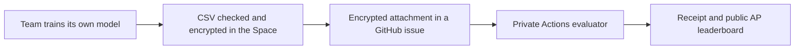

# AI for Nature · Bird habitat challenge

Build habitat rankings for ten birds from German observations and AlphaEarth embeddings. Compare models on one common German validation set, then predict anonymous locations in nearby Central Europe. Teams of 2–3 work for 6.5 hours.

[Competition hub & rules](https://huggingface.co/spaces/Hula-Tech/ai-for-nature-hula-earth) · [Challenge data](https://drive.google.com/drive/folders/1gXsJyZnI8QIbk1RQYL0qNqy1yf0eSaoT) · [Starter code](https://github.com/hulaearth/ai-for-nature-codebase) · [Participant PDF](site/participant-guide.pdf) · [Register](https://github.com/hulaearth/ai-for-nature-competition/issues/new?template=register-team.yml)

## What teams deliver

- A valid prediction for all **35,510** bird-location requests.
- Clear, supported data insights and visualizations.
- A method/code reference and a presentation PDF by **17:30**.
- A **5-minute presentation + 2 minutes of questions**.

The award combines **50 model / 30 insights / 15 presentation / 5 reproducibility** points. Matching the fixed reference earns 15 model points; +0.15 AP earns 50. [Full scoring formula and evidence checklist](docs/scoring.md). Cross-species experiments use the same categories.

## Follow this route

1. Register your team and captain; wait for organizer approval.
2. Download the **40 MB modeling tables** and follow the [starter quick start](https://github.com/hulaearth/ai-for-nature-codebase). Use the shared German validation set. Spatial cross-validation is optional.
3. Try the **120-row practice delivery** before the final rush.
4. Preload the encrypted final inputs; unlock at **13:30**. The table-only component is **4.30 MB**; both optional patch scales bring the complete test input to about **3.10 GB**.
5. Check/encrypt your CSV on the Space. Attach the downloaded JSON to a new GitHub Prediction issue and create the issue before **17:30**. Downloading the JSON alone does not submit it.
6. Check the accepted receipt. Your latest accepted prediction is the default; use the final-choice form to select an older accepted prediction and provide method/code references. Upload slides through the separate presentation form.

[Submission instructions and examples](SUBMISSIONS.md) · [Practical guide](site/guide.html) · [Data explanation](site/data.html)

Each team has five accepted final predictions and ten practice checks. Invalid files do not spend accepted attempts. Original issue creation time decides deadline eligibility, even when scoring is delayed. Exact score ties favor the earlier selected prediction receipt.

## Saturday 24 October 2026

All times are German local time: Europe/Berlin, CEST / MESZ (UTC+02:00). Before 11:00, only downloads and environment/account checks are allowed, including AI-agent work.

| Time | Program |
| --- | --- |
| 10:00 | Registration and coffee; starter code opens. Pages and participant guide are already available. Environment checks only until 11:00. |
| 10:15 | Welcome and AI Nation introduction (Juliana Carneiro da Cunha Baumgartl, about 5 minutes). |
| 10:25 | Challenge brief by Hula Earth and Ames (maximum 10 minutes each), including the datasets. |
| 10:45 | Team formation, challenge/category confirmation and mentor introductions. |
| 11:00 | Hackathon modeling and analysis begin. Teams raise a hand for mentor help. |
| 13:00 | Lunch in the room; no fixed work break. |
| 13:30 | Test-key release on the Space; decrypt preloaded inputs and begin final inference/submissions. |
| 14:00 | Mentor round: every team gets a check-in, including data loading, inference and submission questions. |
| 16:30 | Feature-freeze checkpoint and second mentor round; focus on final inference, figures, slides and delivery. |
| 17:30 | Deadline for predictions, nomination, method/code reference and presentation PDF. |
| 17:45-19:45 | Presentations: 15 teams, 5 minutes + 2 minutes Q&A. |
| 19:45-20:00 | Jury deliberation and final reconciliation. |
| 20:00-20:15 | Awards ceremony. |
| 20:15-20:45 | Dinner and networking. |

## How the platform works



The evaluator scores data only; it never runs team code. Hidden labels and the submission-decryption key stay private. The separate test-input key is published at 13:30. Live public AP is provisional; nominated private AP determines model points after closure. Presentations are collected in private organizer storage.

Training data, pages and the participant guide are available in advance. Starter code opens at **10:00** on event day; analysis and modeling begin at **11:00**. No code or challenge guide belongs in the advance data folder. The data include technical documentation, licenses and checksums. Preserve the notices: the MIT code license does not relicense the observations or AlphaEarth data.

## Maintain this site

The Static Hugging Face Space needs no running CPU service. Build and check locally:

```bash
python3 scripts/build_site.py
python3 scripts/check_site.py
python3 -m unittest discover -s tests -v
node --test tests/*.test.js
python3 -m http.server 8000 --directory site
```

Sources live in `config/`, `scripts/build_site.py`, `site/app.js` and `site/style.css`. Each HTML entry point includes the same design and navigation so linked pages remain styled. Deployment uploads only an explicit public allowlist and verifies its SHA256 hashes.

[Materials-release setup](docs/materials-release.md) · Test-key setup is described in the private runbook.

Organizers use the **private evaluator repository's PRE_EVENT_CHECKLIST.md and RUNBOOK.md** for readiness, credentials, approval, queue processing and closure. The timed jobs need verified permissions and an operator fallback; team approval, final sealing and judging remain human responsibilities. This repository and the Space are public by organizer approval. Keep the starter private until its 10:00 release and the evaluator private throughout.
