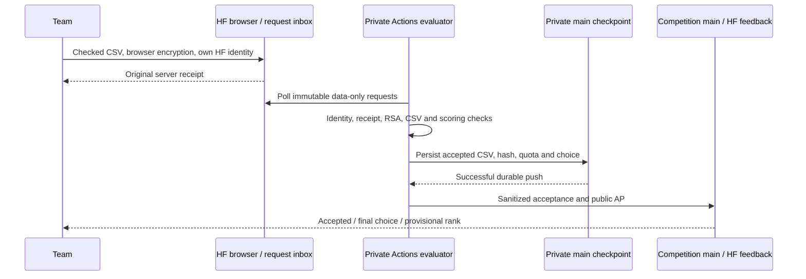

# Evaluator connection and final presentation operations

Use this with [HANDOVER.md](../HANDOVER.md). It explains the connection between
the participant starter, competition pages and **private evaluator**, then the
complete closing-report and slide workflow. Secret values, labels and populated
reports remain private. Checked against evaluator `main` at `c184081` on
23 October 2026; use current files and verification receipts when operating.

## Release and work times

**Release participant data at 10:00 German time on Saturday 24 October 2026
(08:00 UTC)**. This gives roughly an hour for downloads and checks before the
advertised 11:00 work start. Starter/guide delivery is also intended for 10:00;
the separately hosted website must enforce that release. An earlier work start
needs an equal announcement and consistent participant instructions; file
availability alone does not change the competition's preparation rule.

The final feature archives can be downloaded after data release, but remain
encrypted until **13:30 German time**. The same age identity unlocks the core,
climate and water/context test companions. This is separate from the **private RSA
key** used by the evaluator for participant submissions. Deadline remains 17:30.

## How the three codebases connect

| Component | Input | Output / connection |
| --- | --- | --- |
| Participant starter (`ai-for-nature-codebase`) | Supplied train/development features and, after unlock, anonymous final features | Participant runs training/inference; exports `row_id,score` CSV for every supplied final request |
| Competition browser (`ai-for-nature-competition` deployed to HF) | CSV, published config, RSA public document and participant's own HF session | Checks and encrypts CSV; creates a data-only HF request with server receipt |
| Private evaluator (`ai-for-nature-evaluation`) | Immutable request, confirmed identity, RSA secret, frozen solution/reference | Decrypts, validates, scores public split, archives accepted CSV and durable receipt |
| Public feedback publisher | Sanitized evaluator exports in competition `main` | HF receipts, selected-entry leaderboard, roster and launch config |
| Private closing reporter | Sealed choices, successfully published finals, archived accepted CSVs and reporting metadata | Reproduced scores, analysis, full PDF library, offline picker, notes and chart-data archive |

No participant needs evaluator access, an organizer token, a custom webhook or
server setup. The starter's model object is never uploaded for execution. The
interface is the exact prediction CSV contract: currently **159,150 rows**, every
provided ID exactly once, finite `[0,1]` scores, with a 24,000,000-byte CSV limit.



Required wiring is documented in the handover's [secrets table](../HANDOVER.md#secrets-keys-and-permissions):

1. Matching event/Space IDs, manifest, row limits and RSA public key ID in private
   event config and public exports. `site/submission-key.json` contains only the
   matching public document. Baseline provenance is a separate frozen pin.
2. Private evaluator secrets `SUBMISSION_PRIVATE_KEY` and
   `COMPETITION_PUBLISH_TOKEN`; workflow's repository-scoped `GITHUB_TOKEN`
   persists private state. Publisher PAT writes only the competition repo.
3. Competition `HF_SPACE_TOKEN` (or `HF_TOKEN`) mirrors sanitized files to HF.
   Private evaluator does not need that token to read the public HF inbox.
4. Active worker or trusted main `process` drain, followed by public feedback
   publication. `sync` updates the public contract without creating a prediction.

The authoritative native registry and selections live in private
`state/ledger.json`. HF registration/invitations and prediction requests use the
same verified identities. All confirmed members share team quota; only captain
chooses final entry. Preserve original receipts/branches; never merge submitted
requests or execute their contents. Public upload acknowledgement is not acceptance.

The worker polls about every 15 seconds, publishes health about every minute,
and has a separate five-minute backup poll. Public HF feedback is coalesced, so
it can lag the durable private result. Monitor GitHub `site/worker-status.json`
and actual accepted receipts; see the handover for permissions and recovery.

## Private inputs needed for final slides

Having evaluator code alone is insufficient. Before event day, verify these
components against the **same frozen panel**:

| Input | Purpose / preparation |
| --- | --- |
| `private/evaluation/` | Minimal hidden solution, eligibility, manifest and source credits; stage with the privacy-checking bundle helper |
| `private/scoring/` | Frozen reference predictions/calibration/provenance; reporter reproduces the reference |
| `private/submissions/<entry>/submission.csv` | Every accepted final CSV, with ledger byte hash and canonical prediction fingerprint |
| `state/ledger.json` | Teams, original receipts, chosen entries, sealed fingerprint and successfully published final results |
| `private/reporting/manifest.json`, `groups.csv`, `species.csv`, `coverage.json` | Frozen row/group/species/coverage metadata, prepared before seeing team predictions; see private reporting preparation scripts |
| `private/reporting/context-manifest.json`, `context.parquet`, `context-policy.json`, `context-support.parquet` | Optional fixed environmental diagnostics with checked solution/support bindings; retain the complete verified directory |
| `config/reporting.json` | Fixed support/bootstrap settings; do not loosen after looking at results |
| `config/point-maps.json` and `ORGANIZER_MAP_POINTS_1` … `_4` | Optional map binding plus private coordinate payload; prepare with `scripts/prepare_point_maps.py` and run `organizer-map-check.yml` |
| `aifn/assets/` and reporting modules | Cached photographs/rights, bird context, brand artwork, borders, PDF export library and their integrity metadata; no event-day image download needed |

Install **`requirements-report.txt`**, which includes the evaluator lock plus
report rendering/data dependencies. The separate workflow uses Python 3.14.4 on
`ubuntu-24.04`, a 30-minute timeout and private temporary output storage. Full
tests also need Node. Scoring worker dependencies remain separate.

Report refuses premature/unsealed/unpublished results, altered selection
fingerprints, missing accepted archives, incorrect hashes and scores that do not
reproduce. Production map output must remain outside Git. A matching map manifest
with missing/corrupt coordinate secrets is an error, not permission to invent a
map. Environmental slides appear only with the verified context companion.

See the private [report guide](https://github.com/hulaearth/ai-for-nature-evaluation/blob/main/docs/CLOSING_REPORT.md),
[environmental metadata](https://github.com/hulaearth/ai-for-nature-evaluation/blob/main/docs/CONTEXT_REPORTING.md)
and [map setup](https://github.com/hulaearth/ai-for-nature-evaluation/blob/main/docs/POINT_MAP_REPORTING.md).
Older counts and checkboxes in historical sections do not replace current manifests.

## Rehearse before the event

In private evaluator **Actions → Private closing report → Run workflow**, choose
`main`, mode **rehearsal**. Default rehearsal uses **15 invented teams × five
attempts × 159,150 prediction rows** and invented coordinates. It checks native
registry/jury compatibility and unchanged selection state. It does not reveal
production labels, enable finals, publish mock standings or send Slack notices.

```bash
gh workflow run closing-report.yml -R hulaearth/ai-for-nature-evaluation \
  --ref main -f mode=rehearsal
```

To test the signed Drive delivery too, explicitly enable
`deliver_rehearsal_to_drive` (UI checkbox, or add
`-f deliver_rehearsal_to_drive=true`). This writes a labelled synthetic bundle
to the restricted destination. It is an actual upload, not a dry run. Test Slack
separately with its connection workflow; ordinary rehearsal cannot notify Slack.

Download **`closing-report-SYNTHETIC`**, unzip on the actual jury laptop, test
offline selection/reordering/PDF export/fullscreen/projector and retain a backup.
Synthetic libraries can have fewer slides than production because the real
environmental context is absent. Save a slide-order JSON for import after finals;
it contains stable slide IDs, not synthetic scores.

## Final generation: exact event-day sequence

Use private Actions on **main**, with one responsible evaluation operator:

1. At 17:30 preserve the original timely requests. Wait at least two minutes,
   run **Trusted private evaluation → process**, resolve transient failures and
   verify accepted counts/final choices. A timely complete request may be scored
   later; do not ask everyone to upload again during an outage.
2. Run operation **seal**. Confirm the durable private selection fingerprint.
   This freezes each team's chosen model, never their best hidden-score attempt.
3. When organizers are ready to reveal private AP, run **publish-final**. This
   publishes the sealed final model results. It is not a safe pre-event test.
4. On successful evaluation, the workflow automatically invokes **Private closing
   report**. `process`, `sync`, ordinary uploads and `seal` do **not** generate it.
5. Open the run: report generation must reproduce official selected scores,
   then save **`closing-report-PRIVATE`**. Check optional Drive/Slack steps separately.
6. Organizer reviews real results/slides before presentation. Jury combines the
   model component with insights, presentation and reproducibility; AP leader is
   not automatically the overall award winner.

For an authorized operator, the dispatches are:

```bash
# Only after deadline, reconciliation and organizer decision.
gh workflow run evaluate.yml -R hulaearth/ai-for-nature-evaluation --ref main -f operation=process
gh workflow run evaluate.yml -R hulaearth/ai-for-nature-evaluation --ref main -f operation=seal
gh workflow run evaluate.yml -R hulaearth/ai-for-nature-evaluation --ref main -f operation=publish-final
```

**Wait for each run and inspect success before dispatching the next**; CLI dispatch
returns before execution. Do not queue these blindly or automate the decision to
reveal final results. Reporting failure does not undo published official results.

## What is generated

| Output | How to use it |
| --- | --- |
| `jury-slides.html` | Self-contained offline slide picker, previews, presets, running order, presentation and PDF export |
| `closing-slides.pdf` | Complete bookmarked slide library; direct projection fallback |
| `report.html` | Illustrated detailed analysis; inspect support/interpretation before presenting |
| `presenter-notes.html` | Speaking notes and chart interpretation; also embedded below the picker, outside projected view |
| `statistics.json`, `provenance.json` | Analysis and source/report identity, including accepted-entry fingerprints |
| Analysis CSVs | Official choices, all accepted attempts, selection comparison, bird/region results, agreement and uncertainty; context CSVs when enabled |
| `analysis-data.zip` | Reusable chart inputs, column dictionary, table edition of report, notes and per-file hashes; optional exact map inputs |
| `manifest.json` | Top-level file hashes/report identity; analysis and jury packages also carry their own integrity manifests |
| Bird/photograph/context/credit companions | Preserve with shared PDF/bundle; credits also retained in exported PDF attachments |

With current real-panel maps and environmental context, the full library has
**36 slides**: overview; two alternative ten-bird introductions with conservation
badges; selected models/top teams; bird gain/absolute heatmaps; geographic and
matched transfer views; attempts, findings, uncertainty and public/private
comparison; ten prediction maps; six environmental/source diagnostics; closing.
The long library is optional material, not an instruction to present every page.

Current charts use percentage-style **AP points** for gains: CSV difference
`0.034` displays as **+3.4 AP points**. Absolute AP remains a separate view;
neither scale is the jury's model-points total. Unsupported groups are suppressed;
read notes/support rather than interpreting blank cells as zero. Maps use one
leading officially selected model across birds and sampled-site ranks, not
calibrated occupancy. Retrospective best attempts and ensembles are diagnostics,
never replacement official entries or extra awards.

Some optional raw chart inputs contain exact coordinates and reporting metadata.
**Keep populated selector, analysis archive and reports organizer-private.** Only
an organizer-approved presentation should be shown/shared. Nothing in this workflow
deploys private analysis to the public competition Space.

## Choose and present the final slides

1. Download the private Actions artifact or the verified **jury bundle ZIP** from
   the restricted organizer Drive folder. **Unzip locally**; Drive HTML preview
   does not run the selector.
2. Double-click `jury-slides.html` in a modern desktop browser. It works without
   server, sign-in or internet. Choose **Short closing**, **Bird focus**, **Model
   comparisons**, **Prediction maps** or **All slides** as a starting point.
3. Select thumbnails; use **Up**, **Down**, **Remove** to arrange the running order.
   Choose either bird introduction rather than accidentally showing both. **All
   slides** deliberately includes both alternatives and detailed optional pages.
4. Import the saved rehearsal order if useful; it selects final slide IDs without
   importing rehearsal scores. Save the revised order JSON for backup.
5. Use **Export selected PDF** or **Present selection**. If automatic browser
   download fails, use the visible **Download PDF** link after assembly. Selected
   exports are renumbered 1/N. Arrow keys/Space advance; Escape leaves presentation.
6. Review **Presenter notes and chart interpretation** below the selector. They
   are not projected. Retain separate credit companions and embedded attachments.
7. If the picker fails, use `closing-slides.pdf` bookmarks or an already-exported
   selected PDF. Keep a second offline copy/device for the projector.

A shorter eight-slide alternative is a **review proposal**, not an enabled new
automatic generator. The full library and manual selection remain supported.
Overall winners, standout team insights, descriptions of approaches and future
plans require human review/input; predictions cannot tell which method caused a gain.
See private [offline handoff](https://github.com/hulaearth/ai-for-nature-evaluation/blob/main/docs/OFFLINE_PRESENTATION.md).

## Delivery, retries and recovery

- **Actions:** artifact retention is currently **30 days**. Copy the verified ZIP
  to protected long-term storage before expiry. Production rendering stays in
  private runner temporary storage; `state/latest-report.json` records identity
  and storage, not a permanent local runner path.
- **Drive:** configured signed receiver creates jury ZIP, PDF, **Analysis data.zip**,
  START HERE and signed completion receipt in restricted organizer storage. Same
  content/report identity reuses delivery; verify actual `delivered` result.
- **Slack:** optional webhook sends a private run link and aggregate counts,
  not the PDF or hidden data. Channel members need evaluator permission for artifacts.
  Same confirmed report identity does not send twice.
- **Partial failures:** Drive/Slack use `continue-on-error`; green overall workflow
  does not certify them. Actions artifact survives. Fix delivery separately.
- **Regenerate:** after sealed/published finals, run **Private closing report →
  production**; do not rerun final publication just to repair slides:

```bash
gh workflow run closing-report.yml -R hulaearth/ai-for-nature-evaluation \
  --ref main -f mode=production
```

Inspect the resulting job before retrying. Same sources/code produce the same
report ID; changed inputs/implementation produce a new ID and require review.
For uncertain Slack delivery, inspect the channel and private delivery record
before `retry_notification=true`; confirmed messages cannot be resent. Do not
disable integrity checks to repair a report. Restore the correct archive/metadata.

For an authorized **local** rerun after closure, install reporting dependencies,
use the same private snapshot and write outside Git:

```bash
.venv/bin/python -m aifn.report --root . --output-root /protected/closing-output
```

Replace that path with actual protected storage. Map-enabled local runs require
the same chunks or `AIFN_POINT_MAP_PAYLOAD_FILE` pointing to the prepared protected
payload **outside the checkout**. This command renders only; it does not publish
finals, deliver Drive/Slack or checkpoint repository state. Prefer hosted workflow
for the tested complete delivery route. See [handover recovery](../HANDOVER.md#recovery-and-shutdown).
